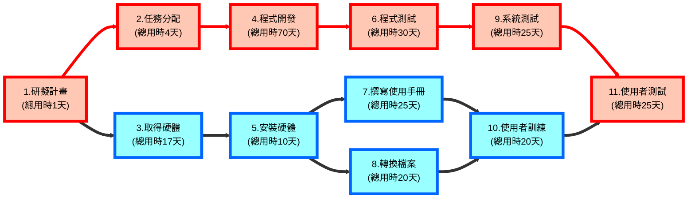
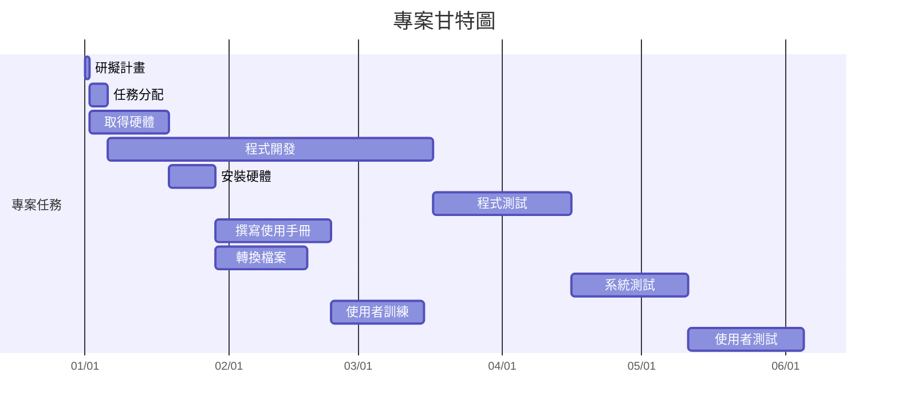

# C113118220 林余柔-個人作業2

## 一、任務基本資料

| 任務 | 任務說明 | 用時(天數) | 前置任務 |
|---|---|---:|---|
| 1 | 研擬計畫 | 1 | - |
| 2 | 任務分配 | 4 | 1 |
| 3 | 取得硬體 | 17 | 1 |
| 4 | 程式開發 | 70 | 2 |
| 5 | 安裝硬體 | 10 | 3 |
| 6 | 程式測試 | 30 | 4 |
| 7 | 撰寫使用手冊 | 25 | 5 |
| 8 | 轉換檔案 | 20 | 5 |
| 9 | 系統測試 | 25 | 6 |
| 10 | 使用者訓練 | 20 | 7、8 |
| 11 | 使用者測試 | 25 | 9、10 |

## 二、PERT/CPM 圖

> 備註：紅色節點代表關鍵路徑，藍色節點代表非關鍵路徑。

## 三、各階段開始與結束時間

| 任務 | 任務說明 | 開始時間 | 結束時間 |
|---|---|---:|---:|
| 1 | 研擬計畫 | 第1天 | 第1天 |
| 2 | 任務分配 | 第2天 | 第5天 |
| 3 | 取得硬體 | 第2天 | 第18天 |
| 4 | 程式開發 | 第6天 | 第75天 |
| 5 | 安裝硬體 | 第19天 | 第28天 |
| 6 | 程式測試 | 第76天 | 第105天 |
| 7 | 撰寫使用手冊 | 第29天 | 第53天 |
| 8 | 轉換檔案 | 第29天 | 第48天 |
| 9 | 系統測試 | 第106天 | 第130天 |
| 10 | 使用者訓練 | 第54天 | 第73天 |
| 11 | 使用者測試 | 第131天 | 第155天 |

## 四、專案甘特圖

## 五、關鍵路徑與最短工期

本專案關鍵路徑：

**1(研擬計畫) → 2(任務分配) → 4(程式開發) → 6(程式測試) → 9(系統測試) → 11(使用者測試)**

關鍵路徑總工期：

**1 + 4 + 70 + 30 + 25 + 25 = 155 天**

故本專案最短工期為 **155 天**。
